# Example: static company profile, with and without Temper

The same brief built two ways: a one-page Thai company profile site for Doi Phrao Hill Roasters, a fictional coffee roaster in Chiang Mai.
The company, people, address and phone number are invented, and the site says so in its footer.

- [`reqs.md`](reqs.md): the shared requirements, with company facts and 15 acceptance criteria
- [`without-temper/`](without-temper/): built by one agent given only "Build what reqs.md in this folder asks for."
- [`with-temper/`](with-temper/): built by the Temper loop over four runs, with every prompt, verdict and diagnosis kept in [`with-temper/.temper/`](with-temper/.temper/), and its house rules in [`with-temper/rules.md`](with-temper/rules.md)
- [`checker/`](checker/): the hidden acceptance checker used to grade both, which neither builder saw

## Final result

Live, once GitHub Pages has built:
[without Temper](https://jamesasuraa93.github.io/self-prompting-agent-system/examples/company-profile/without-temper/)
and
[with Temper](https://jamesasuraa93.github.io/self-prompting-agent-system/examples/company-profile/with-temper/).
You can also open `index.html` in either folder directly.

| Without Temper | With Temper |
|---|---|
| 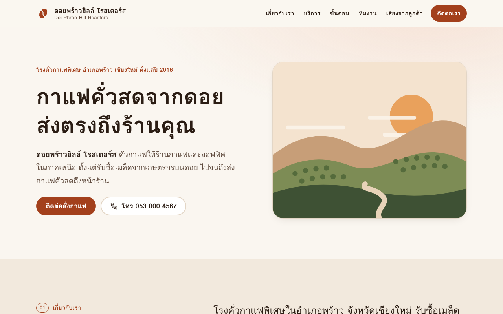 | 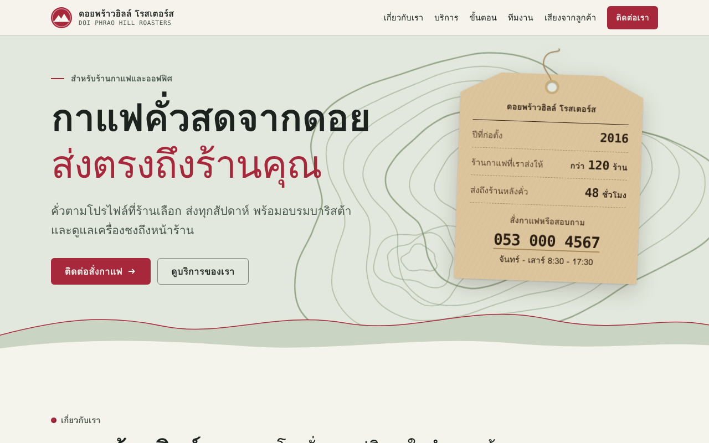 |
| 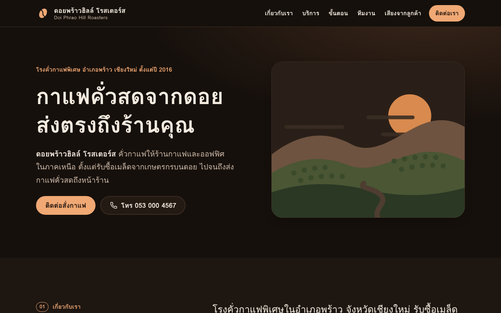 | 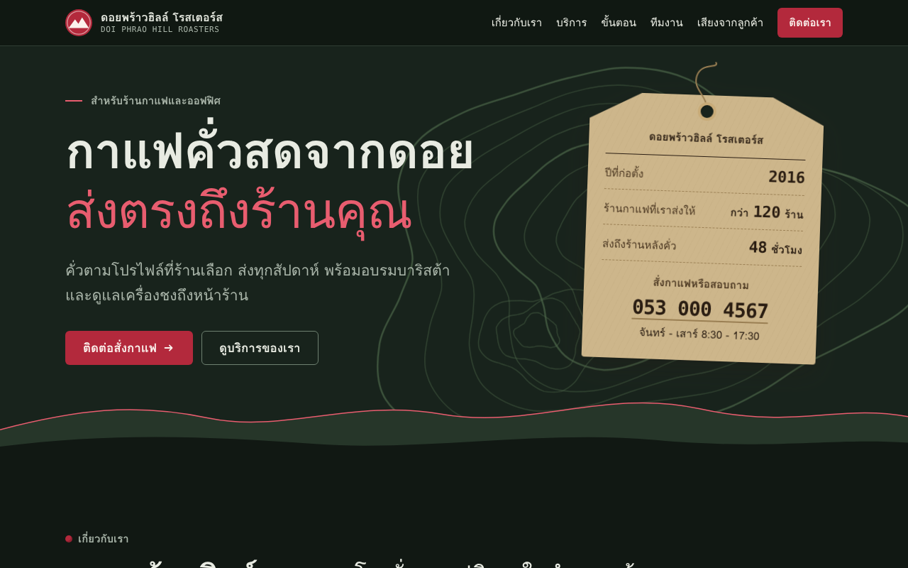 |

Full page, desktop at 1280 px (scaled to half size) and mobile at 375 px:

| Without Temper | With Temper |
|---|---|
| 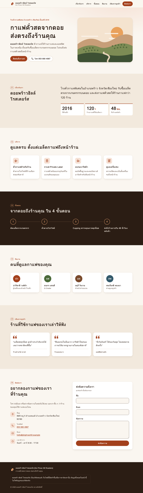 | 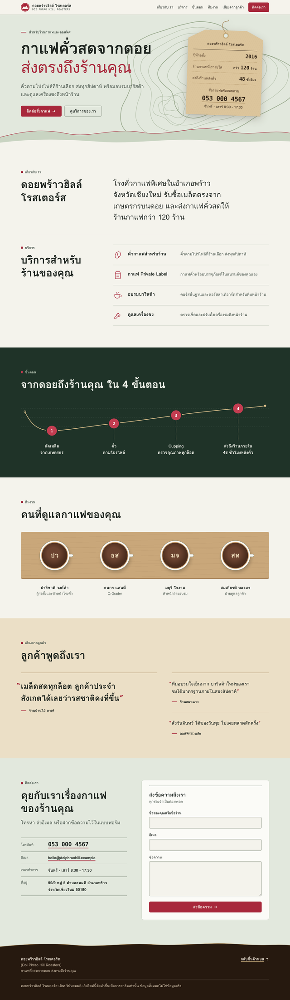 |

| Without Temper, mobile | With Temper, mobile |
|---|---|
| 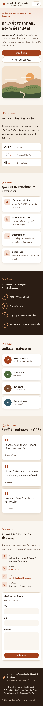 | 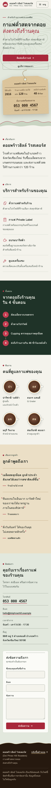 |

Both pass all 35 automated checks.
The Temper site went through four runs and one extra requirement from the owner, so read the history below before comparing them like for like.

## How each side was built

The plain side got one sentence and the folder, and finished in one pass.

The Temper side went through the loop in [`SKILL.md`](../../plugins/temper/skills/temper/SKILL.md) four times.

### Run 001: build

1. The compiler wrote [`prompt.v1.md`](with-temper/.temper/runs/001/prompt.v1.md) from `reqs.md`, adding one environment fact: Playwright with Chromium is installed and can be used to check the page.
2. A fresh executor built the site from that prompt alone.
3. A separate judge graded it against `reqs.md` without seeing the prompt: [`judge.v1.md`](with-temper/.temper/runs/001/judge.v1.md). All 14 hard criteria passed; the `[judgment]` criterion AC15 failed because Thai text in the four-column cards broke mid-word at 1024 to 1280 px.
4. The script returned `pass_with_advisory`, and the run continued because the owner's standing rule is to fix anything that looks off.
5. [`diagnosis.v1.md`](with-temper/.temper/runs/001/diagnosis.v1.md) traced the cause and [`prompt.v2.md`](with-temper/.temper/runs/001/prompt.v2.md) is a targeted edit of v1.
6. The v2 executor found a second cause on its own (Chromium's Thai dictionary splits loanwords such as ทุกล็อต and บาริสต้า), fixed both, and the v2 judge passed everything: [`judge.v2.md`](with-temper/.temper/runs/001/judge.v2.md).

| Plain request | Temper v1 | Temper v2 |
|---|---|---|
| 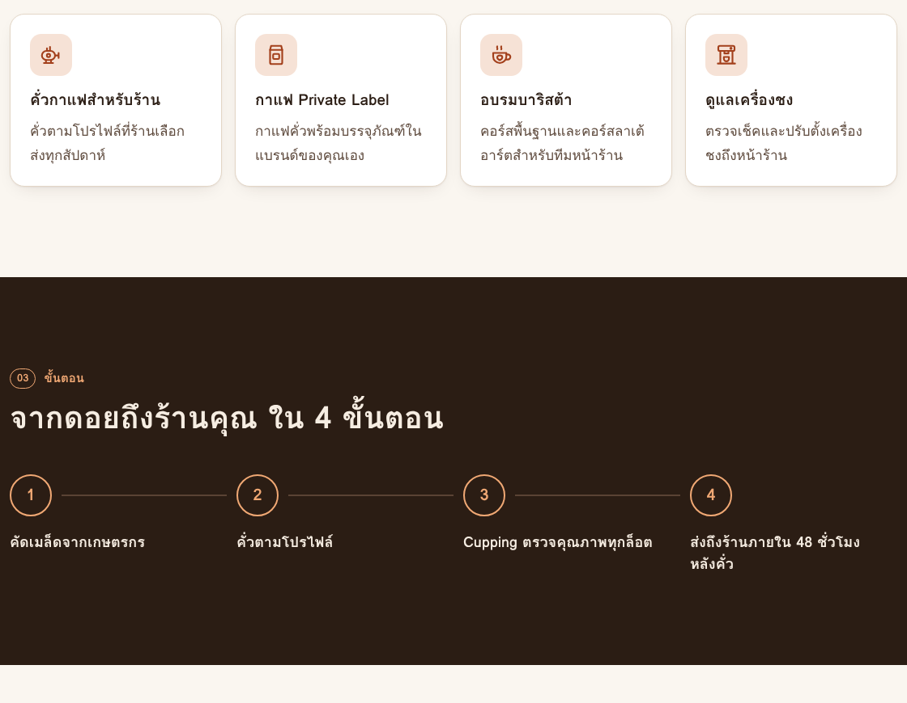 | 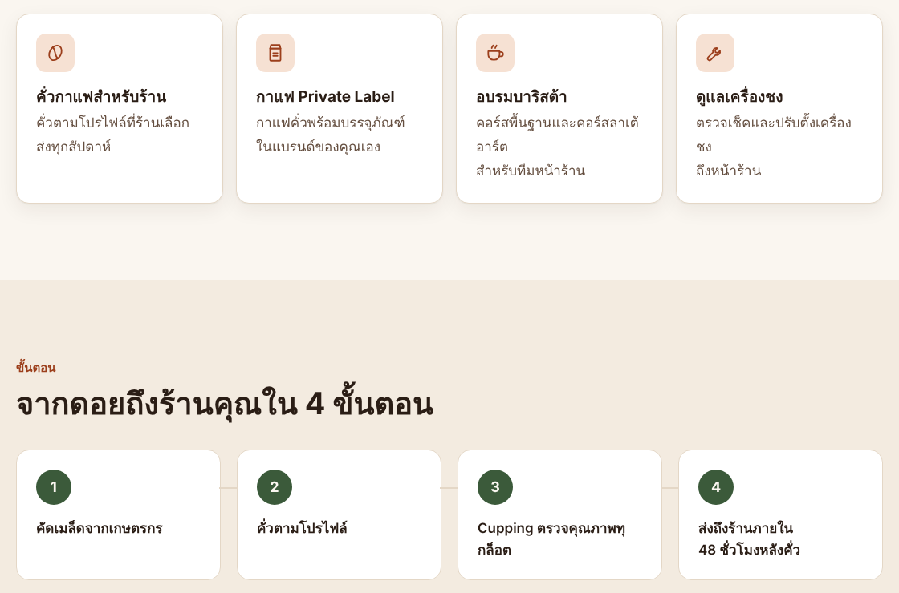 | 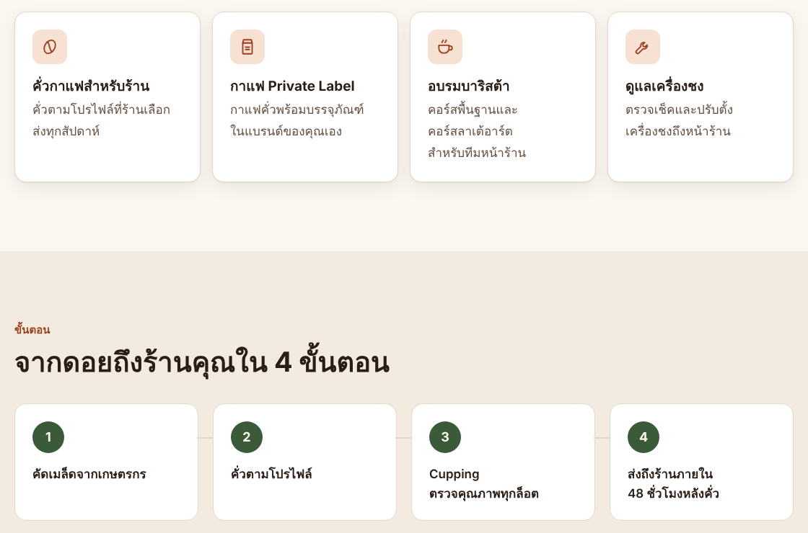 |

### Run 002: polish

The v2 judge had passed the site but listed small nits: a footer box much wider than its text, unequal hero buttons at 360 px, a short first line in one card, the company name repeated in the hero, a `#top` link with no target, and a 1 px overlap under the sticky header.
The owner asked for them to be fixed.
A new run started from [`prompt.v1.md`](with-temper/.temper/runs/002-polish/prompt.v1.md), with the run 001 lessons from `learnings.md` copied into it, and the judge passed it: [`judge.v1.md`](with-temper/.temper/runs/002-polish/judge.v1.md).

### Run 003: design

Looking at the result, the owner said the site lacked taste: tidy, but it could be any company's template.
That is a requirements gap, since `reqs.md` only asked for "finished and intentional", so it was written into [`with-temper/reqs.md`](with-temper/reqs.md) as R16 plus two `[judgment]` criteria, AC16 (a memorable identity drawn from the subject) and AC17 (crafted details in both themes).
The fonts constraint stayed: no web fonts and nothing over 100 KB, so identity had to come from composition, color and inline SVG.
The executor was pointed at the `frontend-design` skill: [`prompt.v1.md`](with-temper/.temper/runs/003-design/prompt.v1.md).

The redesign added a contour map of the hill behind the hero, a kraft lot tag carrying the key numbers, the process drawn as a roast curve, team initials in espresso cups seen from above, and a different layout for every section.
The judge passed all 14 hard criteria and AC15 to AC17: [`judge.v1.md`](with-temper/.temper/runs/003-design/judge.v1.md).

### Run 004: polish, with house rules

The run 003 judge had listed 19 nits; the owner asked for all of them to be fixed.
[`prompt.v1.md`](with-temper/.temper/runs/004-polish/prompt.v1.md) quotes every one, with the lessons from runs 001 to 003.
The executor fixed 18 of them, among them the candy-pink red in dark mode, the near-invisible footer hills and form card, the label hidden under the sticky header, the empty contact column, the ragged process labels and the sparse team row, which now sits on a wooden cupping table.
The one it could not fix needs web fonts, which R1 and R2 rule out.

This run also introduced [`rules.md`](with-temper/rules.md), the project's house rules, starting with forbidden dashes.
The judge checked the site and Temper's own files against it with `temper.py rules-check`, and everything passed: [`judge.v1.md`](with-temper/.temper/runs/004-polish/judge.v1.md).

Lessons from all runs are in [`learnings.md`](with-temper/.temper/learnings.md).

## Results

| | Plain request | Temper |
|---|---|---|
| Hidden checker (35 checks, AC1 to AC14) | 35/35 | 35/35 after every run |
| AC15, looks finished | graded only by the builder itself | failed in run 001 v1, passed from v2 on |
| Design identity (AC16, AC17, added in run 003) | not asked for | passed |
| House rules (`rules.md`, added in run 004) | not checked | pass |
| Runs and versions | 1 | 4 runs, 5 versions |
| Tokens | 156k | 1.72M |
| Wall time | 12 min | 96 min |

On the first two runs, which shared the plain side's requirements, Temper cost about 3.6 times the tokens and produced the same automated score.
What it added was a reviewer with fresh eyes, which caught a visual bug the builder had introduced and missed in its own review.
The bigger difference in the final screenshots comes from runs 003 and 004, where the owner raised the bar and the loop had a way to absorb that: a new requirement, a judge that grades against it, house rules, and lessons carried forward.

## Still open

The run 004 judge passed everything and still listed 18 nits, a different and smaller set than the run 003 list that run 004 fixed.
A judge asked to name every nit will always find some, so polish runs end when the owner says the remaining ones are not worth the tokens.
The ones it ranked first:

- At 960 px and up the testimonials leave a large empty block under the short lead quote.
- At 1200 px and up the services section shows two rules at different offsets, and its heading does not line up with the first row.
- On phones and tablets the contour lines run behind the hero text.
- From 768 to 959 px the contact form stretches across the full width.
- In the Loma fallback font the opening and closing quote marks look mismatched, and the contact phone number is set in a heavy monospace.
- In dark mode the small red dots before section labels nearly disappear, and the hero accent still leans pink.

## Fairness notes

The checker was written and validated against a throwaway reference site before either side ran, and it was kept outside both project folders.
The transcripts of both builders were searched afterwards; neither opened the checker or the reference site.
Two checker bugs were found while grading and fixed for both sides alike: a word list that missed "สาธิต" (demo) in the footer notice, and a dark-mode contrast check that ran while color transitions were still animating.
The plain side's `reqs.md` is the original; the Temper side's carries the reworded AC13 and the run 003 design criteria, and only the Temper side has a `rules.md`.
One build per side, so there is no variance estimate.

## Run the checker

```bash
cd checker && npm install
```

```bash
node check.cjs ../without-temper
```

```bash
node check.cjs ../with-temper ./shots
```

It prints one JSON object per check and, with a second argument, saves screenshots at 375 px and 1280 px in light and dark mode.
